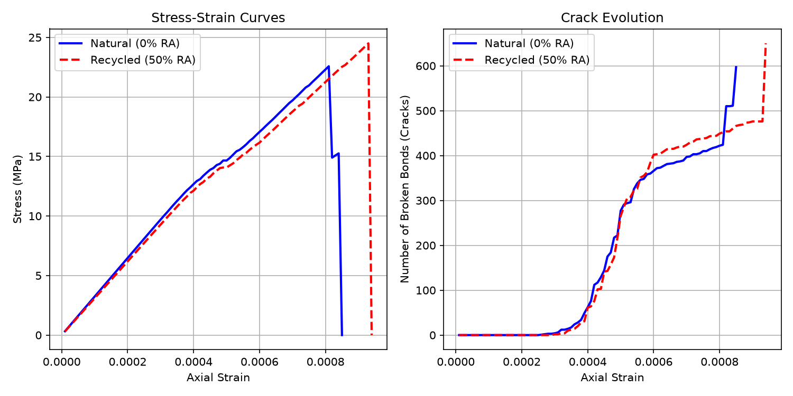
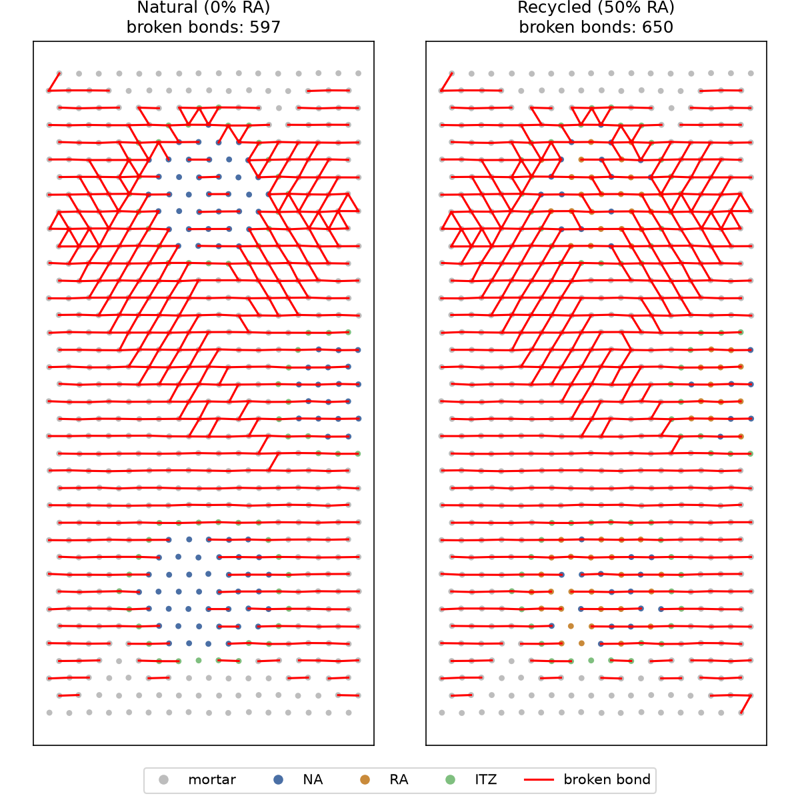

# Mesoscale Fracture Model of Natural vs. Recycled Aggregate Concrete

A lightweight 2D bonded-particle (lattice) model that simulates uniaxial compression of concrete at the mesoscale and compares **natural aggregate concrete (NAC)** with **recycled aggregate concrete (RAC)**. The model resolves three material phases (mortar, aggregate, interfacial transition zone), tracks bond-level fracture, and produces stress–strain curves, crack-evolution curves and crack-pattern maps.

The implementation is written from scratch in Python using only NumPy, SciPy and Matplotlib, with a vectorised sparse-matrix solver. It runs on any OS in about 10 seconds.



---

## Highlights

- **Three-phase mesostructure**: mortar, natural or recycled aggregate, and an ITZ automatically identified from the particle neighbour graph.
- **Quasi-static lattice solver**: equilibrium is solved at each displacement increment with a sparse linear system (`scipy.sparse`), with fully vectorised stiffness assembly.
- **Event-driven fracture**: overstressed bonds are removed one at a time, most critical first, with re-equilibration after each break, so stress redistribution and crack propagation emerge naturally.
- **Three failure modes**: tension, Mohr–Coulomb shear (cohesion plus friction), and compressive crushing.
- **Reproducible**: seeded random number generation, so both concrete types share the same geometry and differ only in material assignment.

---

## Repository structure

```
.
├── rac_lattice.py          # Main model (NumPy/SciPy), runs anywhere
├── rac_demo.py             # Reference implementation for the YADE DEM framework (see below)
├── requirements.txt
├── rac_comparison.png      # Stress-strain and crack-evolution curves
├── rac_crack_patterns.png  # Final crack patterns
└── README.md
```

---

## Quick start

```bash
git clone https://github.com/avvas200/nac_rac.git
cd nac_rac
pip install -r requirements.txt
python rac_lattice.py
```

Outputs written to the working directory:

| File | Content |
|---|---|
| `natural_stress_strain.txt`, `recycled_stress_strain.txt` | Axial strain vs. stress (Pa) |
| `natural_broken_bonds.txt`, `recycled_broken_bonds.txt` | Axial strain vs. cumulative broken bonds |
| `rac_comparison.png` | Stress–strain and crack-evolution comparison |
| `rac_crack_patterns.png` | Phase map with broken bonds highlighted |

---

## Model description

### Geometry and phases

A 100 mm × 200 mm specimen is discretised into about 600 circular particles (mean radius 3 mm) arranged on a randomly perturbed hexagonal lattice. Three circular aggregate zones are placed inside the specimen. Each aggregate particle is assigned to natural aggregate (NA) or recycled aggregate (RA) according to the recycled replacement fraction. Mortar particles bonded directly to an aggregate particle are reassigned to the ITZ phase.

Each phase scales the mortar properties by a factor:

| Phase | Stiffness / strength factor |
|---|---|
| Mortar | 1.0 (E = 25 GPa, σ<sub>t</sub> = 3.5 MPa) |
| Natural aggregate | 2.0 |
| Recycled aggregate | 1.2 |
| ITZ | 0.6 |

### Bonds

Neighbouring particles are connected by bonds with normal and shear springs. For a bond between particles *i* and *j* with length $L$ and cross-section $A = t\,(r_i + r_j)$:

- Bond modulus: harmonic (series) mean, $E_b = \dfrac{2E_iE_j}{E_i + E_j}$
- Normal stiffness: $k_n = E_b A / L$; shear stiffness: $k_s = 0.25\,k_n$
- Tensile strength: $F_t = \sigma_t A$, using the weaker phase, with ±20% random scatter to represent heterogeneity

### Failure criteria

A bond breaks when any of the following is exceeded:

| Mode | Criterion |
|---|---|
| Tension | $F_n > F_t$ |
| Shear (Mohr–Coulomb) | $\lvert F_s \rvert > 2F_t + \tan\varphi \cdot \max(-F_n, 0)$ |
| Crushing | $-F_n > 10\,F_t$ |

### Solver

Loading is displacement-controlled: the bottom row of particles is fixed, and the top row is moved downward in increments of $10^{-5}$ axial strain, with both rows clamped laterally. At each increment the reduced system

$$K_{ff}\,u_f = -K_{fp}\,u_p$$

is solved for the free degrees of freedom. The most critical overstressed bond is removed, the system is re-solved, and this repeats until no bond exceeds its strength. Stress is computed from the reaction forces on the top row. The simulation stops when stress falls below 10% of the peak.

---

## Results

Results from a single run (seed 42):

| Case | Peak stress (MPa) | Strain at peak | Broken bonds at failure |
|---|---|---|---|
| Natural (0% RA) | 22.6 | 0.00081 | 597 |
| Recycled (50% RA) | 24.5 | 0.00093 | 650 |



Both specimens show the qualitative behaviour expected of concrete in compression: a linear elastic stage (initial modulus around 32 GPa), the onset of distributed vertical splitting cracks, coalescence into an inclined shear band, and brittle failure.

### Observations and limitations

- **RAC appears slightly stronger than NAC in this configuration**, which contradicts experimental evidence. This follows from the parameterisation rather than the solver: because stiffness and strength are scaled by the same factor in every phase, all phases crack at the same strain, and a softer recycled aggregate reduces the stiffness mismatch with the mortar (and hence stress concentration). The model does not yet represent the adhered old mortar or the additional weak ITZ around recycled aggregate, which are the main causes of reduced strength in real RAC.
- The model is 2D with a regular-lattice basis, which introduces some directional bias in crack paths.
- Broken bonds are removed entirely, so there is no contact or friction between crack faces after failure; post-peak behaviour is therefore more brittle than in real concrete.
- Results come from a single random realisation; statistical conclusions would require many seeds.

---

## Possible extensions

- **Model fidelity**: independent stiffness and strength factors, a two-ITZ representation for recycled aggregate, random aggregate shapes and gradings, and contact between crack faces.
- **Uncertainty quantification**: Monte Carlo over random seeds and mesostructures to obtain distributions of strength.
- **Machine learning**:
  - Surrogate models (e.g. neural networks or Gaussian processes) that map mix design parameters to strength, trained on simulated data.
  - Graph neural networks operating directly on the particle–bond graph to predict damage evolution or crack paths.
  - Inverse design and parameter calibration against experimental stress–strain curves using Bayesian optimisation.

---

## YADE reference implementation

`rac_demo.py` implements the same model concept using the [YADE](https://yade-dem.org) discrete element framework with the concrete particle model (`CpmMat`). It requires a Linux installation of YADE and is run with:

```bash
yade -n -x rac_demo.py
```

The NumPy/SciPy version (`rac_lattice.py`) is the primary implementation in this repository and is the one used for the results above.

---

## Reference

The phase-ratio assumptions are based on the mesoscale framework of Mei et al. (2024).
<!-- TODO: add the full citation (authors, title, journal, volume, pages, DOI) -->

---

## Author

**[Your Name]**, MSc in Computer Science
[email] · [LinkedIn] · [personal website]
